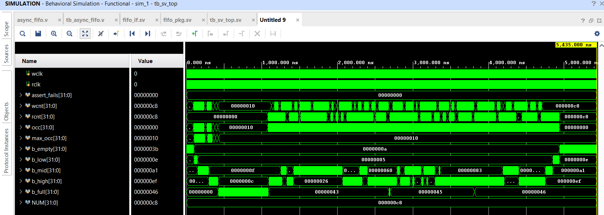
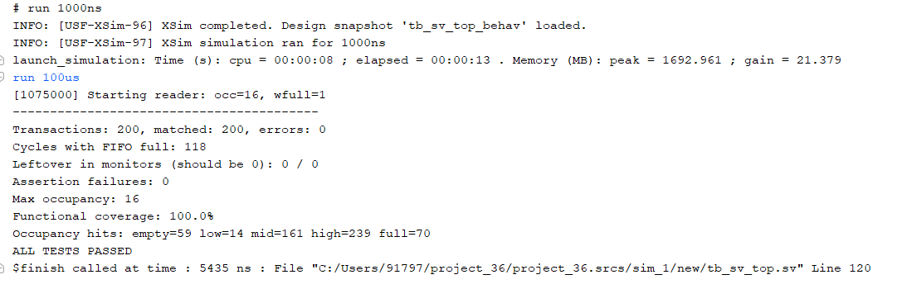

## Results
- Simulation (Vivado): 500 words written/read, 0 errors, ALL TESTS PASSED
- Synthesis (Vivado, Artix-7 xc7a200t): 28 LUTs, 40 FFs
- ## SystemVerilog Verification

Constrained-random testbench (sv_tb/) for the async FIFO, built from scratch (no UVM library):

- *fifo_if.sv*: interface bundling the FIFO signals
- *fifo_pkg.sv*: transaction (random data/gap), generator, write/read drivers, write/read monitors, scoreboard
- *tb_sv_top.sv*: top-level, clocks (100 MHz / ~71 MHz), DUT, assertions, functional coverage

Reader is held back at start so the FIFO fills completely, then released to test full and drain behaviour.

### Results (Vivado XSim)
| Check | Result |
|---|---|
| Transactions / matched / errors | 200 / 200 / 0 |
| Max FIFO occupancy | 16 (full) |
| Assertion failures (gray-code pointers change by <= 1 bit/cycle) | 0 |
| Functional coverage (occupancy bins: empty, low, mid, high, full) | 100% |

